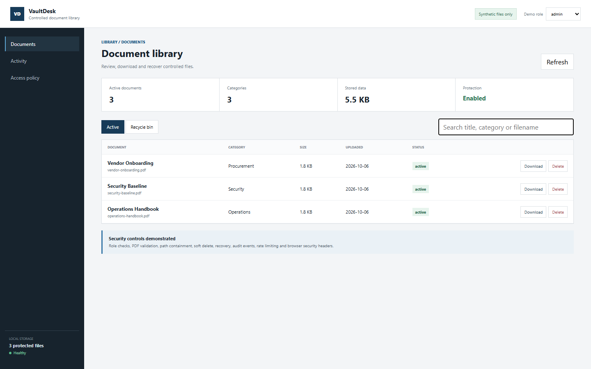

# Secure Document Library Demo

[English / README principal](README.md) · Português (Brasil)

Um portal de documentos FastAPI com informações sensíveis removidas, que demonstra controle de acesso e tratamento defensivo de arquivos com PDFs gerados.



## Controles de segurança

- Papéis demonstrativos de visualizador, editor e administrador, com autorização no servidor.
- Verificações rigorosas da extensão PDF, do nome do arquivo e do conteúdo.
- Verificação de contenção do caminho resolvido para bloquear path traversal.
- Exclusão lógica e recuperação explícita a partir de um diretório de lixeira isolado.
- Eventos de auditoria para operações de upload, exclusão e restauração.
- Limitação da frequência de requisições e cabeçalhos de segurança para o navegador.
- Limite demonstrativo de dois megabytes por upload.

## Execução

```bash
python -m venv .venv
.venv\Scripts\activate
python -m pip install -r requirements.txt
python -m uvicorn app.main:app --reload
```

Abra `http://127.0.0.1:8000`. Três PDFs fictícios são gerados na primeira execução.

## Testes

```bash
pytest -q
```

## Escopo

Este projeto foi reconstruído com um histórico novo. Ele não contém documentos institucionais, nomes, dados de contas, credenciais nem caminhos de armazenamento de produção. Os papéis baseados em cabeçalhos são intencionalmente um mecanismo transparente de demonstração, não uma autenticação de produção.

## Licença

MIT
